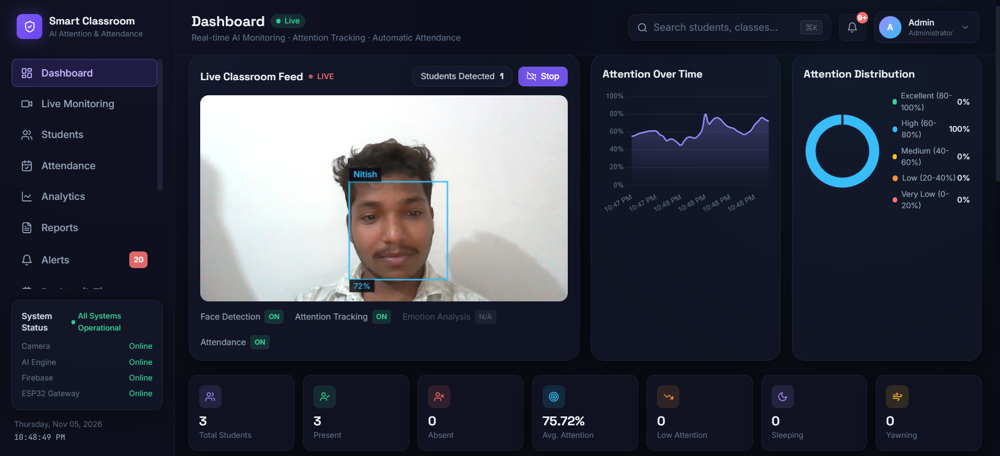
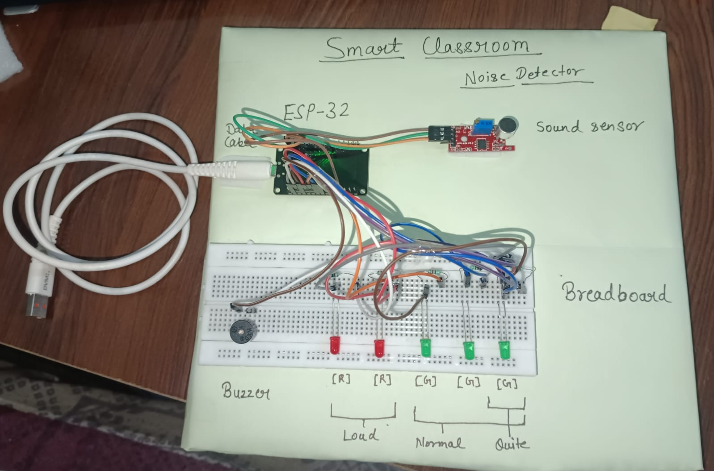

# Smart Classroom — AI Attendance & Attention Monitoring

A full-stack system that uses computer vision to **mark attendance by face recognition**, **score student attention in real time**, and **monitor classroom noise with an ESP32**, all on one live dashboard.

> B.Tech (AI & ML) project · Python · Flask · MediaPipe · React · ESP32

<p align="center">
  
</p>

## What it does

| Feature | How it works |
|---|---|
| **Face detection & recognition** | MediaPipe detects faces; `face_recognition` (dlib) matches them against enrolled students (match tolerance 0.5). |
| **Automatic attendance** | A recognised student is marked present once per day (duplicate-safe). |
| **Attention score (0–100)** | Weighted score from eye aspect ratio, blink rate, head pose, face presence, sleep duration and yawn count. Weights and thresholds live in `backend/config/attention_weights.json`, not in code. |
| **Sleep & yawn detection** | Eye-closure duration and mouth aspect ratio from MediaPipe FaceMesh landmarks. |
| **Classroom noise monitor** | ESP32 + sound sensor sends the noise level over Wi-Fi; the dashboard shows Quiet / Normal / Loud. |
| **Physical indicators** | LEDs and a buzzer on the ESP32 show the noise state locally (1 green = quiet, 3 green = normal, 2 red + buzzer = loud). |
| **Dashboard** | React dashboard with live camera feed, attention charts, attendance summary, alerts, reports (PDF) and device status. |

## Architecture

```
Webcam ─► React Dashboard ─► Flask REST API ─► Classroom Pipeline
                                                     │
      ┌──────────────┬──────────────┬────────────────┼───────────────┐
      ▼              ▼              ▼                ▼               ▼
 Face Detection  Face Recognition  Eye Tracking   Head Pose     Sleep / Yawn
 (MediaPipe)     (dlib)            (FaceMesh)     (solvePnP)    Detection
      └──────────────┴──────────────┴────────────────┴───────────────┘
                                     ▼
                         Weighted Attention Engine
                                     │
                 ┌───────────────────┼───────────────────┐
                 ▼                   ▼                   ▼
          Attendance Manager   Notification Service   Firebase (optional)

ESP32 + sound sensor ──Wi-Fi (HTTP POST /api/devices/esp32/sound)──► Flask ──► Dashboard "Classroom Noise" card
```

## Tech stack

- **Backend:** Python 3.10, Flask, OpenCV, MediaPipe, `face_recognition` (dlib), NumPy
- **Frontend:** React 18, Vite, Tailwind CSS, Axios
- **Storage:** Firebase Firestore (optional; the app also runs fully in memory)
- **Hardware:** ESP32 DevKit V1, HW-484 sound sensor, LEDs, active buzzer (Arduino C++)

## Hardware

Final build: ESP32 DevKit V1, HW-484 sound sensor (analog output), 3 green + 2 red LEDs with 220 Ω resistors, and an active buzzer, mounted on a 1 ft × 1 ft board.

Wiring, pin table and sketch: see [`hardware/README.md`](hardware/README.md).

<p align="center">
  
</p>

## Quick start (Windows)

Run everything from the project root.

### 1. Backend
```bash
python -m venv venv
venv\Scripts\activate
pip install -r backend/requirements.txt
copy backend\.env.example backend\.env
python -m backend.app
```
Backend runs on `http://localhost:5000`. If `dlib` fails to install, see `backend/requirements-no-dlib.txt` and `docs/INSTALLATION_GUIDE.md`.

**Run without Firebase** (everything works, but data is kept in memory only):
```bash
python -c "from backend.app import create_app; create_app(use_firebase=False).run(host='0.0.0.0', port=5000)"
```

### 2. Frontend
```bash
cd frontend
npm install
npm run dev
```
Dashboard runs on `http://localhost:5173`.

### 3. Hardware (optional)
Flash `hardware/esp32_sound_wifi/esp32_sound_wifi.ino`, after setting your Wi-Fi name/password and your laptop's IP at the top of the file. Details in [`hardware/README.md`](hardware/README.md).

> **Never commit** `backend/.env` or `backend/config/firebase_credentials.json`. They are in `.gitignore`.

## API highlights

| Endpoint | Purpose |
|---|---|
| `POST /api/process-frame` | Runs the full CV pipeline on one camera frame |
| `POST /api/students/register` | Enrol a student from 3–5 photos |
| `GET /api/attendance/today` | Today's attendance |
| `POST /api/devices/esp32/sound` | ESP32 pushes `{ "level": 0-4095 }` |
| `GET /api/devices/esp32/sound` | Latest noise level and state |
| `GET /api/devices/esp32/status` | ESP32 online/offline (online if data arrived in the last 10 s) |
| `GET /api/system/status` | Health of every AI module |

Full reference: [`docs/API_DOCUMENTATION.md`](docs/API_DOCUMENTATION.md).

## Project structure

```
backend/      Flask API + CV pipeline (modules/, services/, api/, config/, tests/)
frontend/     React + Vite + Tailwind dashboard
hardware/     ESP32 sketches, wiring guide
docs/         Installation, deployment, API docs, changelog
research_paper/  IEEE-format paper and presentation
```

## Testing

```bash
pytest backend/tests -v
```

## Known limitations

Stated openly so the results can be judged fairly:

- **Attention score is a heuristic, not a trained model.** Thresholds were tuned by hand with one webcam in lab conditions and need re-calibration for a real classroom (camera angle, lighting, distance).
- **Head-pose estimation was corrected late in the project.** An inverted 3D face model used with `solvePnP` gave wrong yaw/pitch; after fixing it, attention scores behaved much better in webcam tests. It has only been checked on one person at normal webcam distance, not on a full classroom with varied angles.
- **Emotion recognition is not implemented**, and is not part of the score.
- **No authentication.** `/api/users` is plain CRUD, not a login system; do not expose this publicly as-is.
- **Firebase free tier:** the dashboard polls frequently; the free daily read quota (50k) can be exhausted. Use the "run without Firebase" command for demos, or reduce polling.
- **ESP32 → backend is plain HTTP without a token**, intended for a trusted local network only. The laptop's IP changes on hotspot networks and must be updated in the sketch.
- **Noise levels** (Quiet ≤ 100, Normal ≤ 750) were set by hand for one sensor and one room.
- Sleep/yawn thresholds were not validated on a large number of people.

## Future work

- Validate head pose and re-calibrate attention thresholds on recorded classroom data
- Add authentication (JWT) and role-based access
- Cache/aggregate Firestore reads to stay inside the free tier
- Add a token to the ESP32 → backend request
- Multi-camera support and a real emotion-recognition module

## Author

**Nitish Kumar** — B.Tech AI & ML
GitHub: [@nitishkumar708](https://github.com/nitishkumar708)

## License

Academic / final-year-project use. Adapt freely for coursework and research with attribution.
